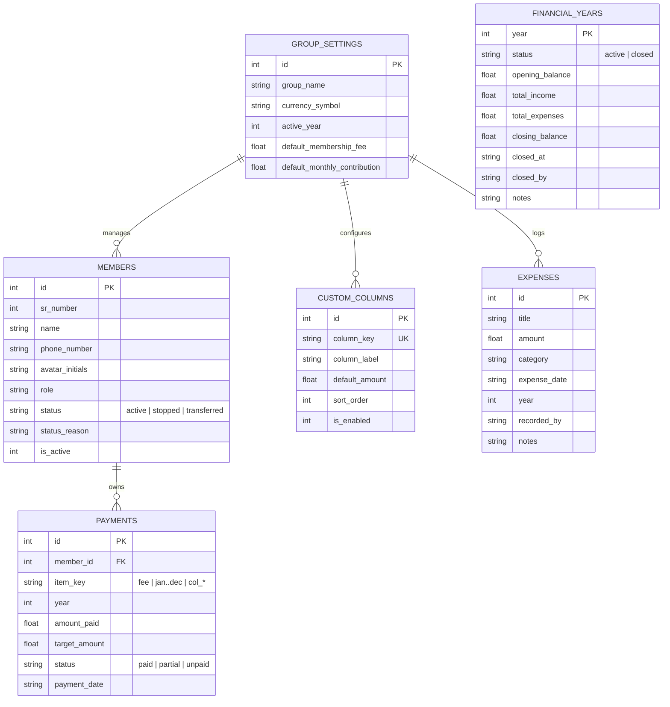

# Shair — Women Monthly Contribution & Membership Fee App

An elegant, minimalistic, and dead-simple Android application built with React Native (Expo SDK 58) and persistent local SQLite storage. Designed specifically for women's rotating savings clubs, chamas, and welfare associations.

- **Currency**: **MWK (Malawian Kwacha)** with localized thousand formatting.
- **Top Buffer**: Generous safe-area inset buffer preventing any collision with Android camera cutouts or status bars.
- **Bottom Navigation**: Persistent, tactile 3-tab navigation bar (*Ledger*, *Expenses*, *Columns*) with active badge indicators.

---

## 🌸 Key Capabilities & Features

### 1. Interactive Master Contribution Ledger
- **Pinned Identity Columns**: `SR` (Serial Number) and `Member Name` remain frozen on the left while horizontally panning through the months and custom levies.
- **Ordered Columns**:
  - `SR` (Auto-incremented, clean formatting)
  - `Member Name` (with initials avatar and member role)
  - `Membership Fee` (Standard dues)
  - **12 Months of the Year**: `Jan`, `Feb`, `Mar`, `Apr`, `May`, `Jun`, `Jul`, `Aug`, `Sep`, `Oct`, `Nov`, `Dec`
  - **Dynamic Custom Columns**: Toggleable and customizable (e.g. Welfare, Uniform, Party Levy)
  - **Total Column (Automatic)**: Programmatically computes the sum of all contributions logged for each member in real time.
- **Bottom Summary Row**: Automatically computes:
  - Total Membership Fees collected
  - Total collected per individual month (`Jan`..`Dec`)
  - Total collected per custom column
  - **Grand Total** of all circle contributions

---

### 2. 📉 Integrated Expenses & Net Balance Engine
- **Automatic Net Deduction**: Any expenditure logged immediately deducts from total group savings:
  $$\text{Available Net Balance} = \text{Total Income Collected} - \text{Total Group Expenses}$$
- **Expense Categorization**: Categories tailored for community groups: *Venue & Hall Rental*, *Refreshments & Food*, *Welfare & Bereavement Support*, *Supplies & Stationery*, and *Transport*.
- **Full Audit Trail**: Displays the date, amount deducted, responsible officer/sister, and optional notes/receipts.
- **Delete / Restore**: Deleting an expense automatically returns the money to the available Net Balance.

---

### 3. ⚙️ Dynamic Column & Fund Rule Customizer
- **Create Custom Levies**: Add new fee categories (e.g., *End of Year Party*, *Uniform Levy*, *Emergency Fund*) with one tap.
- **Set Target Amounts**: Assign default expected amounts per member.
- **Toggle Visibility**: Turn columns on/off using clean switches without losing historical records.

---

### 4. ⚡ Rapid Payment Entry Modal
- **Zero-Friction Logging**: Tapping any cell in the ledger opens a clean bottom sheet.
- **One-Tap Mark Full**: Instantly mark as paid with one tap of the green checkmark button.
- **Custom / Partial Amounts**: Input any custom amount or clear a payment back to unpaid status.

---

### 5. 👥 Contributor Management & Status Tracking
- **Lifecycle Statuses**: Members can be marked as `Active`, `Stopped` (with reason, e.g. withdrew or completed term), or `Transferred` (e.g. relocated to another chapter).
- **Visual Indicators**: Visual badges and distinct avatar badge highlights on stopped/transferred contributors.
- **Filtering**: Instant tabular filter strip by status (`All`, `Active`, `Stopped`, `Transferred`, `Due`).

---

### 6. 💾 Local Backup & Restore
- **Zero-Cloud Data Sovereignty**: Export complete offline JSON backups of members, payments, expenses, and settings at any time.
- **Native Sharing**: One-tap export via Android system sheet to WhatsApp, Google Drive, Gmail, or local storage using `expo-sharing` & `expo-file-system`.
- **Fast Restore**: Direct copy-paste restore mechanism with transactional verification.

---

### 7. 📄 Financial PDF Reports & Statements
- **Print & PDF Generation**: Generates clean, printable HTML-based audit statements and ledgers using `expo-print`.
- **Instant Sharing**: Share PDF ledger reports directly with club members.

---

### 8. 🎨 Design & Aesthetic System
- **Theme**: *Terracotta & Plum Community Finance* (Warm Tactile Minimalism).
- **Colors**:
  - **Terracotta Rose (`#944430`)**: Collective warmth, call-to-actions, and accents.
  - **Deep Plum (`#7E4F70`)**: Heritage, stability, and custom fund identifiers.
  - **Emerald Green (`#1E6753`)**: Verified, paid status badges.
  - **Warm Amber (`#C8872A`)**: Partial payments & upcoming targets.
  - **Soft Cream Canvas (`#FAF7F5`)**: Soft, eye-friendly background that prevents screen fatigue.
- **Tabular Figures (`tnum`)**: All monetary figures render with fixed-width numerals for alignment.

---

## 🗄️ Database Architecture (Local SQLite)

Database: `circle_fund.db` via `expo-sqlite` (100% offline, zero sign-in required).



### Financial Year Close & Carry-Forward Lifecycle

1. **Active Cycle**: Members make payments, expenses are tracked against `settings.active_year`.
2. **Year Close Execution**:
   - Computes total income collected, total expenses, and net surplus.
   - Archives the year with `status = 'closed'`, snapshotting totals, timestamp, closing officer, and remarks.
   - Creates the subsequent cycle (`year + 1`) initialized with `opening_balance = carriedForwardAmount`.
   - Transitions `group_settings.active_year` to the new year.
   - All historical records remain intact and immutable while viewing archived cycles.
3. **Audit & Reopening**: Treasurers can switch cycles via the Cycle Switcher to inspect historic closed years, with the option to reopen an archived cycle if adjustments are needed.

---

## 📱 Project Structure

```
shair/
├── App.tsx                     # Main application entry point & root stage navigator
├── app.json                    # Expo configuration & plugins (sqlite, file-system, sharing)
├── package.json                # Project dependencies and scripts (start, test, build)
├── tsconfig.json               # TypeScript configuration with test exclusions
├── __tests__/                  # Automated unit test suite
│   └── financialMath.test.ts   # Tests for income, expense deductions, dues & formatting
├── template/                   # UI/UX design mockups and token specifications
├── src/
│   ├── constants/
│   │   └── theme.ts            # Terracotta & Plum color tokens, spacing, radiuses
│   ├── types/
│   │   └── index.ts            # TypeScript interfaces for database, state & member statuses
│   ├── utils/
│   │   └── financialMath.ts    # Isolated financial math engine (income, expenses, balances, columns)
│   ├── db/
│   │   ├── index.ts            # SQLite initialization, schema creation, migrations & seeding
│   │   └── dbService.ts        # Database queries (CRUD, backup JSON export & restore transaction)
│   ├── context/
│   │   └── AppContext.tsx      # Global reactive state provider & automated compute engine
│   ├── components/
│   │   ├── SummaryHeaderCard.tsx  # Top financial card (Net Balance, Collections, Expenses)
│   │   ├── QuickPaymentModal.tsx  # Cell-tap bottom sheet for 1-tap payment logging
│   │   └── BottomNavBar.tsx       # Bottom 3-tab navigation bar with badge counters
│   └── screens/
│       ├── SplashScreen.tsx       # Welcoming branded launch splash
│       ├── OnboardingScreen.tsx   # First-run setup for group name, year & targets
│       ├── LedgerMatrixScreen.tsx # Spreadsheet contribution table (SR, Name, Fee, Months, Total)
│       ├── ExpensesScreen.tsx     # Expenses tracker that deducts from total balance
│       └── CustomColumnsScreen.tsx# Manager for dynamic/custom columns
```

---

## 🚀 Running the App & Tests

```bash
# Start the Expo development server
npm start

# Run automated financial calculation unit tests
npm test

# Run TypeScript typecheck
npx tsc --noEmit

# Or directly target Android emulator / device
npx expo run:android
```

---

## ⚡ Over-The-Air (OTA) Updates & EAS Builds

Shair is configured with `expo-updates` and linked to EAS with automated channel routing:

### 1. Building Base APKs
```bash
# Build production APK configured for the "production" update channel
npx eas-cli@latest build --platform android --profile production-apk

# Build preview APK
npx eas-cli@latest build --platform android --profile preview
```

### 2. Publishing Instant Over-The-Air Updates
When you modify React components, styles, or queries without adding new native Android code:
```bash
# Publish instant update to production APKs
npm run update:prod -- --message "Describe your update"

# Or publish to preview testers
npm run update:preview -- --message "Describe your update"
```
The installed app checks for updates automatically on launch (`ON_LOAD`), downloads the new JS bundle seamlessly in the background, and preserves local SQLite databases.

